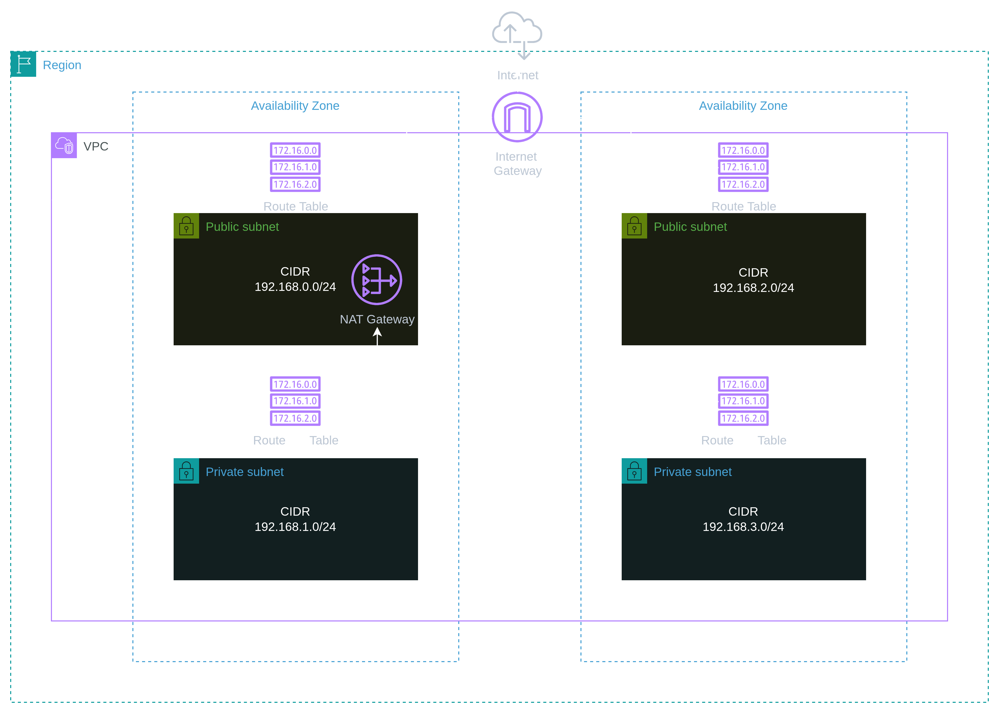
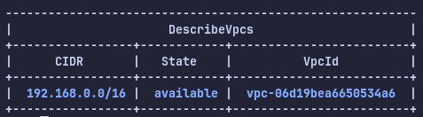
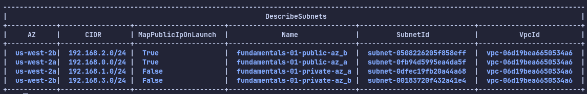
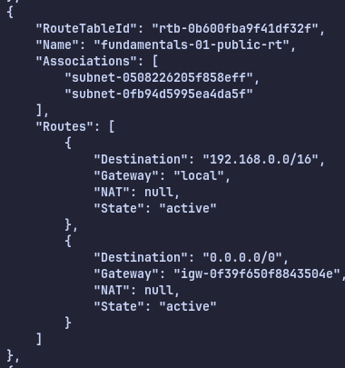
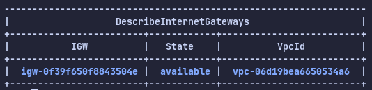
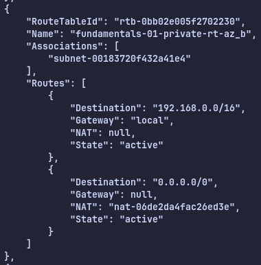
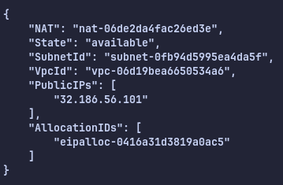
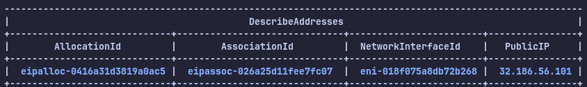

# 01 - VPC & Subnet

> **Status:** Implemented and validated

## 1. Objective

Understand how an Amazon VPC provides a logically isolated network and how subnets divide its IP address space.

## 2. Scenario

Create a small, isolated network foundation for future AWS experiments. This lab defines:

- One VPC with CIDR block `192.168.0.0/16`.
- One Internet Gateway (IGW) attached to the VPC.
- Two public subnets, one in each of two Availability Zones:
    - AZ A: `192.168.0.0/24`
    - AZ B: `192.168.2.0/24`
- Two private subnets, one in each Availability Zone:
    - AZ A: `192.168.1.0/24`
    - AZ B: `192.168.3.0/24`
- One shared public route table with a default route to the IGW, associated with both public subnets.
- One Elastic IP (EIP) allocated for the NAT Gateway.
- One NAT Gateway deployed in the public subnet in AZ A, providing outbound internet access for both private subnets.
- Two private route tables, one per private subnet, each with a default route pointing to the shared NAT Gateway.

## 3. Architecture Diagram


## 4. Requirements and assumptions

- An active AWS Learner Lab session.
- AWS credentials with permission to create and inspect VPCs and subnets.
- Terraform CLI and AWS CLI installed.
- Region configured through `aws_region` in `terraform/variables.tf` or a local tfvars file (do not commit sensitive tfvars files).

## 5. Implementation

The Terraform configuration is in [`terraform/`](terraform/). It discovers the available Availability Zones in the selected region and uses the first two.

| Component | Implementation |
|---|---|
| `aws_vpc.lab` | Creates the VPC with DNS support and DNS hostnames enabled. |
| `aws_internet_gateway.lab` | Attaches an Internet Gateway (IGW) to the VPC. |
| `aws_subnet.public` | Creates two public subnets, one in each selected Availability Zone (AZ), and enables public IPv4 address assignment at launch. |
| `aws_subnet.private` | Creates two private subnets, one in each selected AZ. |
| `aws_route_table.public`, `aws_route.public_internet`, and `aws_route_table_association.public` | Create one shared public route table, add a default route (`0.0.0.0/0`) to the IGW, and associate the table with both public subnets. |
| `aws_eip.nat` and `aws_nat_gateway.lab` | Allocate an Elastic IP (EIP) and create one NAT Gateway in the `az_a` public subnet. |
| `aws_route_table.private`, `aws_route.private_nat`, and `aws_route_table_association.private` | Create one route table per private subnet, add a default route through the shared NAT Gateway, and associate each table with its subnet. |

Both private subnets use the same NAT Gateway in `az_a`. This keeps the deployment to one NAT Gateway, but makes it a shared dependency for private-subnet egress and may incur cross-AZ data-transfer charges.

## 6. Deployment

From this directory:

```bash
cd terraform
terraform init
terraform fmt -check
terraform validate
terraform plan
terraform apply
```

Review the plan before applying. It includes the VPC, four subnets, IGW, route tables and routes, EIP, and NAT Gateway.

## 7. Validation and testing

Complete the checklist and record actual results. The boxes use Markdown task-list syntax; change `[ ]` to `[x]` when a check is complete. Do not mark an item as complete until it has been checked.

### Configuration and plan

- [x] `terraform fmt -check` completes without formatting errors.
- [x] `terraform validate` completes successfully.
- [x] Review `terraform plan`; confirm it proposes the intended network resources and no unexpected changes.
- [x] Apply the configuration and confirm Terraform completes without errors.
- [x] Run `terraform output` and record the VPC ID, VPC CIDR, selected AZs, subnet IDs/CIDRs, and NAT Gateway ID/AZ.

### AWS resource checks

- [x] Confirm the VPC uses `192.168.0.0/16` CIDR block.
  - VPC details:  

- [x] Confirm there are two public subnets (`192.168.0.0/24` and `192.168.2.0/24`) and two private subnets (`192.168.1.0/24` and `192.168.3.0/24`), each in the expected VPC and selected AZ. Public subnets assign public IPv4 addresses on launch while private subnet can't do that.  
  - Subnet details:

- [x] Confirm both public subnets use the shared public route table, whose `0.0.0.0/0` route points to the VPC's IGW.  
  - Public route table:  

  - Internet gateway:  

- [x] Confirm each private subnet uses its own private route table and each `0.0.0.0/0` route points to the shared NAT Gateway.
  - Private route table on AZ a:  

  - Private route table on AZ b:  

- [x] Confirm the NAT Gateway is in the `az_a` public subnet and has an associated EIP.
  - NAT gateway details:  

  - Elastic IP details:



## 8. Troubleshooting

_To be completed during the lab._

## 9. Cost and cleanup

This configuration creates a NAT Gateway and allocates an EIP, both of which may incur charges; NAT Gateway data processing and cross-AZ traffic may also add costs. Check current AWS pricing and Learner Lab policies before deployment. No compute instances or load balancers are created by this lab.

When finished:

```bash
terraform destroy
```

Verify in the AWS Console or with the AWS CLI that the lab's VPC, subnets, IGW, NAT Gateway, EIP, and route tables have been removed.

## 10. Lessons learned

- Planning non-overlapping CIDR blocks up front makes it easier to divide a VPC into public and private subnets.
- A subnet's public or private role depends on its route table and routes, not only its name or CIDR block.
- The shared NAT Gateway reduces the number of NAT Gateways, but it is a dependency for both private subnets and can lead to cross-AZ traffic costs.
- NAT Gateway and EIP costs make reviewing the plan and destroying lab resources after use important.
